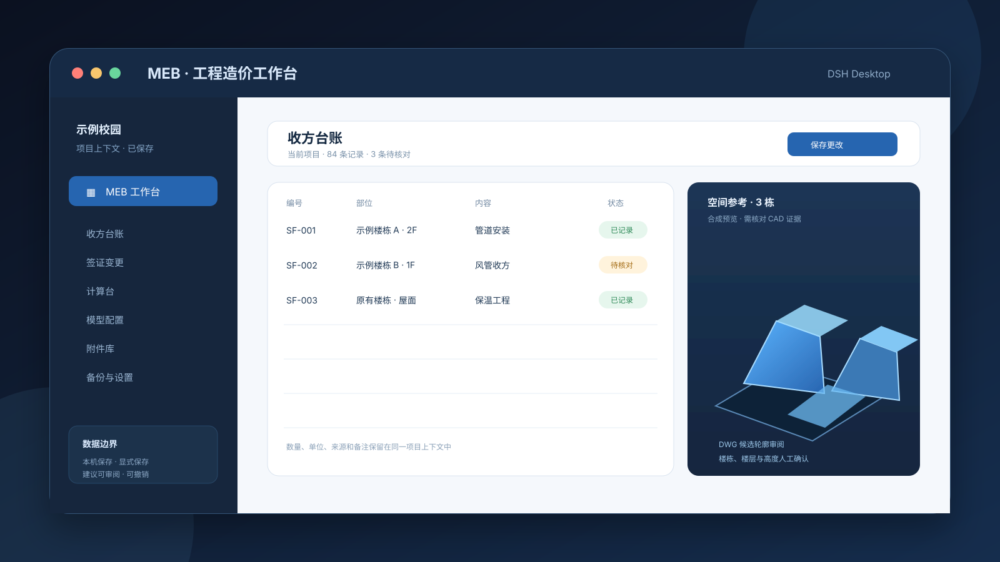
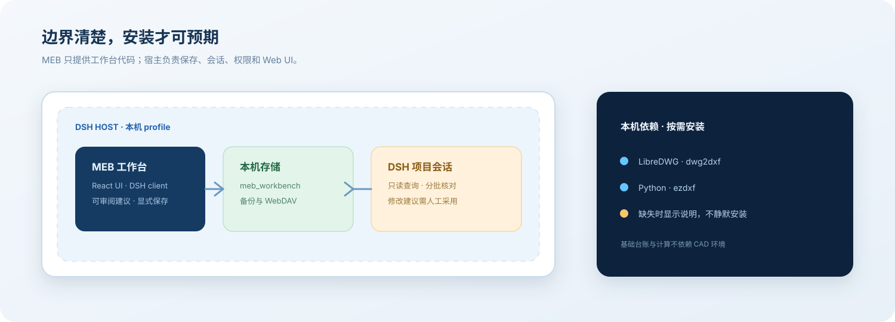

# MEB

<div align="center">

### 工程造价人的 DSH 工作台

把项目台账、计算过程、CAD 核对和 DSH 项目助手放进同一个本地项目上下文。

<p>
  <a href="https://github.com/baiye1997/MEB/releases"></a>
  <a href="https://github.com/baiye1997/MEB/blob/main/LICENSE"></a>
  <a href="https://github.com/baiye1997/MEB/actions/workflows/verify.yml"></a>
  <a href="https://github.com/topics/dsh-plugin"></a>
</p>

<p>
  <a href="https://github.com/baiye1997/MEB">源码</a> ·
  <a href="https://github.com/baiye1997/MEB/releases">版本</a> ·
  <a href="https://github.com/awesome-dsh-plugin/awesome-dsh-plugin/pulls">市场收录</a> ·
  <a href="https://github.com/baiye1997/MEB/issues">问题反馈</a>
</p>

</div>

<p align="center">
  
</p>

MEB 适合需要持续核对“这张表属于哪个项目、数量来自哪份资料、计算使用了什么参数”的工程造价工作。它运行在 DSH Desktop 内，业务数据由 DSH 宿主保存。

## 能做什么

- 收方、签证变更、产值、合同和个人材料价格台账
- Excel 粘贴，以及 `.xlsx`、`.xls`、`.csv`、`.tsv` 导入导出
- 电缆、母线槽、支吊架、保温、风管和自定义规则计算
- 参数、公式、来源和历史入账快照
- DWG 候选轮廓审阅、楼栋配置、拆分和模型预览
- 项目范围内的 DSH 查询、证据核对和可撤销修改建议
- 本机保存、显式保存、撤销、备份恢复和可选 WebDAV 同步

MEB 不提供账号、云端数据库或独立后端。

## 在 DSH Desktop 中安装

默认 DSH 不带插件市场。官方「添加插件」窗口接受 npm 包名、Git spec 或本地目录。

<p align="center">
  
</p>

### 推荐：npm 包

1. 打开 DSH Desktop 的「添加插件」。
2. 输入 `meb-workbench`。
3. 检查来源、版本和依赖提示。
4. 点击「安装」，按 Desktop 提示刷新或重启。
5. 在左侧面板打开 **MEB 工作台**。

### GitHub 源码

在「添加插件」中输入：

```text
github:baiye1997/MEB#main&path:workbench
```

GitHub 子目录安装依赖 DSH 的 Git spec。Windows 遇到 `&path:` 子目录解析问题时，改用 npm 包或本地目录。

### 本地目录

输入本地 `workbench` 目录路径。适合开发、离线检查和未发布版本。

### Desktop 命令

也可以使用 DSH Desktop 随附的命令运行时管理 `desktop` profile：

```sh
dsh plugin --profile desktop add meb-workbench
```

普通 npm CLI 不管理保留的 `desktop` profile。Plugin Market 是可选插件；没有安装 Market 时，直接使用「添加插件」入口。

## DWG 依赖

基础台账和计算不依赖 CAD。DWG 识别需要本机安装：

- LibreDWG 的 `dwg2dxf`
- 可导入 `ezdxf` 的 Python

<p align="center">
  
</p>

npm 包不携带虚拟环境。MEB 会在 DWG 页面显示依赖说明，不会静默执行系统安装。macOS 示例：

```sh
brew install libredwg
python3 -m pip install ezdxf
```

如果 Python 不在默认路径，设置 `MEB_PYTHON` 后重启 DSH。Windows/Linux 请使用对应发行版的 LibreDWG 和 Python 安装方式。

## 开发

```sh
cd workbench
npm ci
npm run verify
npm audit --omit=dev --audit-level=high
```

`npm run verify` 执行逻辑测试、渲染检查、生产构建和 npm 包结构检查。

需要本地 CAD 环境时，源码 checkout 可运行：

```sh
npm run setup:cad
```

发布包使用系统级 `dwg2dxf` 和可导入 `ezdxf` 的 Python，不会携带项目内 `.venv`。

## 发布

```sh
cd workbench
npm run verify
npm pack --dry-run
npm publish --access public
```

发布包包含编译产物、`dsh.bundle.patch`、README 和 License；不包含本机数据、依赖目录、导出文件、Python 虚拟环境或缓存。

## 数据边界

- MEB 使用 DSH 的 `meb_workbench` storage domain。
- 原始文件可以作为本机引用；引用路径不会同步到 WebDAV。
- 导出、备份和同步文件写入 DSH 数据目录，不写入 npm 包目录。
- DSH 建议只生成可审阅、可撤销的修改建议；保存仍由用户明确触发。
- DWG 轮廓、楼栋身份、楼层和高度需要人工核对，不能视为施工级 BIM。

## 质量门禁

公开提交前运行：

```sh
cd workbench
npm ci
npm run verify
npm audit --omit=dev --audit-level=high
```

仓库 CI 会重复执行 Verify。真实工程图纸、业务备份、认证日志和宿主数据不进入 Git；仓库里的模型与表格 fixture 均为合成测试数据。

## 仓库结构

```text
docs/images/                 # README 使用的可版本化 SVG 说明图
workbench/src/               # DSH host/client 源码
workbench/src/model-viewer/  # 合成模型预览源码
workbench/test-fixtures/     # 隔离、非业务测试 fixture
workbench/dsh.bundle.patch   # DSH bundle 入口
workbench/package.json       # npm + DSH manifest
workbench/README.md          # 包内开发说明
```

## 开源许可

MEB 自身代码使用 MIT License。项目还使用 MIT、Apache-2.0 和 SIL OFL 组件；直接依赖、嵌入字体和本地组件的归属见 [THIRD-PARTY-NOTICES.md](THIRD-PARTY-NOTICES.md)。

## 参与贡献

Issue 和 Pull Request 都欢迎。请保持 fixture 合成化，不提交凭据和业务文件，并在提交前运行 `npm run verify`。

MIT © MEB contributors
